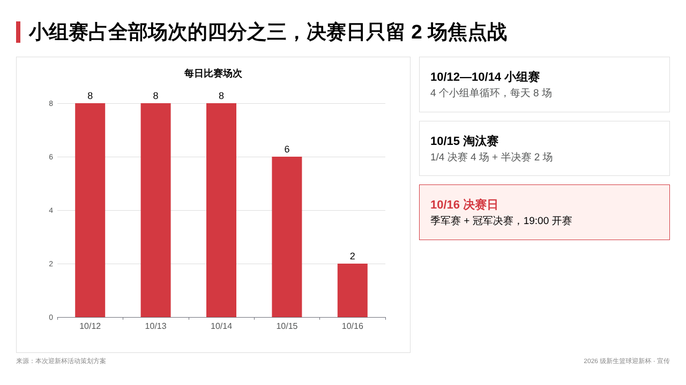

# Agent办公实践PPT制作Skill实践

ICT 大赛实践赛题 **1.16「基于 AI 开发者空间的 PPT 制作实践」** 作品。

由智能体安装 [PPTCraftSkill](https://gitcode.com/agent-best-practices/PPTCraftSkill) 中的 `pptx-craft` 技能，把一句话主题“帮我做个关于2026年计算机学院新生篮球迎新杯的宣传PPT”做成一份 **8 页可编辑 .pptx**。

| 内容 | 位置 |
| --- | --- |
| 成品 PPT | [Agent办公实践PPT制作Skill实践作品/2026计算机学院新生篮球迎新杯宣传.pptx](Agent办公实践PPT制作Skill实践作品/2026计算机学院新生篮球迎新杯宣传.pptx) |
| 对话记录 | [Agent办公实践PPT制作Skill实践作品/Agent办公实践PPT制作Skill实践.md](Agent办公实践PPT制作Skill实践作品/Agent办公实践PPT制作Skill实践.md) |
| 作品说明 | [Agent办公实践PPT制作Skill实践作品/readme.md](Agent办公实践PPT制作Skill实践作品/readme.md) |
| 每页预览 | [Agent办公实践PPT制作Skill实践作品/预览/](Agent办公实践PPT制作Skill实践作品/预览/) |
| 每页 HTML 与生成脚本 | `Agent办公实践PPT制作Skill实践作品/页面HTML/`、`.ppt-work/gen_pages.py` |

